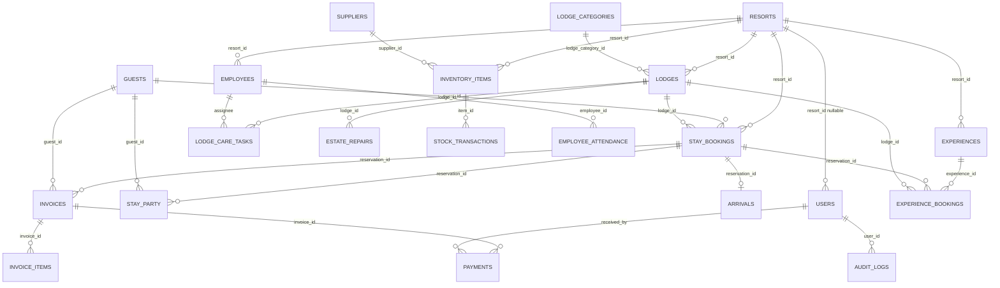

# CoralCove project document

This document explains the CoralCove desktop application as it exists in this repository. After reading it you should know what the program does, how a click becomes a database change, which thread runs which work, what each Java file is for, and how one administrator covers many resorts.

CoralCove has no HTTP server and no remote API. The word API here means the public Java methods the screens call.

This repository used to be a single-hotel desk; the running product is CoralCove, a multi-resort desk. The old database file is not migrated.

## 1. What the program is

CoralCove is an offline resort-group desk. A person uses it on one computer to:

- keep several resorts in one SQLite file
- book villas and cottages, arrive and depart guests, and bill them
- run lodge care, estate repairs, and experiences (spa, water, dining, laundry, minibar)
- record staff, attendance, and stock
- read reports that follow the resort selected in the top bar

The file is `data/coralcove.db`, next to the working directory, unless `CORALCOVE_DB` is set. Sample rows load only from Settings. They are marked `is_sample = 1`.

The project is an Apache NetBeans Ant project. The entry class is `coralcove.Main`. The window title is `CoralCove | Resort Management`. The minimum window size is 1200×750. The sidebar is about 245 pixels. Colors are navy `#1B2430`, gold `#C4A35A`, and content `#F7F4EF`.

## 2. Stack

| Piece | Choice |
| --- | --- |
| Language | Java 17 (`javac --release 17`) |
| UI | Swing. Layouts are `BorderLayout`, `GridBagLayout`, and `CardLayout`. There are no `.form` files. |
| Look | FlatLaf. If it fails, the system look and feel is used. |
| Database | SQLite, `lib/sqlite-jdbc-3.49.1.0.jar` |
| Charts | JFreeChart `lib/jfreechart-1.5.6.jar` |
| Tests | JUnit 4 and Hamcrest, test classpath only |
| Packaging | `manifest.mf` main class `coralcove.Main`, classpath `lib/sqlite-jdbc`, `lib/flatlaf`, `lib/jfreechart` relative to `dist/CoralCove.jar` |
| Logging | `java.util.logging` file `data/coralcove.log` |

Money is `BigDecimal`. `Money.of(double)` is not used. Dates in the database are ISO-8601. The UI prints `dd-MM-yyyy` and `₹`. PDF and print use `Rs.` because Helvetica has no rupee glyph. The clock zone is the selected resort's zone, otherwise Asia/Kolkata.

## 3. Layers

```
Swing panels  ->  services (rules, one transaction)  ->  DAOs (SQL)  ->  SQLite
```

Panels do not prepare statements. DAOs do not decide whether a stay overlaps. Services throw `AppException` with a sentence the screen can show. `Transactions.in` turns auto-commit off, runs the work, commits, and rolls back on failure.

`DatabaseManager` opens a new connection for each call. It sets `PRAGMA foreign_keys=ON` and `busy_timeout=5000`. There is no pool.

## 4. Threads

There is no thread pool and no timer.

1. `main` calls `SwingUtilities.invokeLater` and returns.
2. The event dispatch thread builds the login window, then the main frame.
3. `Ui.run` does database work on a `SwingWorker` and applies the result on the event thread.
4. `Session.dataChanged` runs listeners on the thread that changed the data. The dashboard hops back to the event thread.
5. `DatabaseManager.init` is synchronized.
6. `SettingsService` keeps the time zone in a volatile cache and clears it when the resort filter changes.
7. Session listeners are a `CopyOnWriteArrayList`.
8. `PasswordHasher` uses one static `SecureRandom`.

Killing the process hard can leave `data/coralcove.log.0.lck`. Delete that lock if logging stops. SQLite allows one writer. Close a second window if you see "database is locked".

## 5. One admin, many resorts

`Session.resortFilter()` is the switcher.

- `null` means every resort. Only an administrator may select that. Lists then include a resort name, and totals skip resorts with `active = 0`.
- A number means that resort only.

On login, `AuthenticationService` sets the filter. A non-admin must have `users.resort_id`; the filter becomes that id and the top bar is a label. An administrator starts on the first active resort (the seeded Beach property), not on All resorts. The combo in `TopBar` can move them, including to All resorts. Changing it calls `Session.setResortFilter` and refreshes the visible card.

`ResortScope` is the write check:

- `assertOwns(resortId)` throws `That record belongs to another resort.` when the filter is set and the row's resort is different.
- `resolve(connection, chosen)` uses a positive chosen id after that check, otherwise the filter, otherwise the first active resort. If none exists it throws `Choose a resort before saving.`

These saves call `resolve`: lodge, employee, stock item, experience. A stay copies `resort_id` from its lodge and checks `assertOwns` on that lodge. Arrival and departure check the stay. Care tasks, repairs, invoices, and experience bookings do not store their own `resort_id`; they follow the lodge or the stay.

The lodge dialog shows a resort picker only when the filter is null, so an administrator on All resorts must name the property. Other create screens rely on `resolve`, so switch to the property before saving when you are on All resorts.

New non-admin users created in Settings receive the current filter, or the first active resort when the filter is null.

Tax and the time zone come from the resort row. All resorts falls back to the first active resort for tax and for "today". `group_settings` stores only `demo_loaded`.

## 6. Rules that do not change with the names

Overlap: `newCheckIn < existingCheckOut AND newCheckOut > existingCheckIn`. Ignore `CANCELLED` only.

Booking and the lodge assignment commit in one transaction.

After departure the lodge goes to turn-down, not Ready, until a lodge-care task is `COMPLETED` with inspection `PASSED` and no pending or confirmed stay covers today. Otherwise it stays Held. `CLOSED` is sticky. Manual `IN_STAY` is rejected.

Billing: tax is the resort percent of (line sum minus discount). Discount cannot exceed the pre-tax subtotal. Several payments are allowed. Overpay is rejected. A refund is a negative payment and cannot exceed the amount paid. Status is `UNPAID`, `PARTIALLY_PAID`, `PAID`, or `REFUNDED`. Checkout is allowed with a balance left. Check-in creates an invoice with a `ROOM` line. `SERVED` orders that are not yet billed attach on departure.

VIP: visits (`ARRIVED` or `DEPARTED`) at least 3, or `amount_paid` at least 50000.

Payment methods: `CASH`, `CARD`, `UPI`, `BANK_TRANSFER`.

Invoice line kinds: `ROOM`, `RESTAURANT`, `LAUNDRY`, `MINIBAR`, `MISC`.

Experience order types: `RESTAURANT`, `ROOM_SERVICE`. Statuses: `NEW`, `PREPARING`, `READY`, `SERVED`, `CANCELLED`.

Care priority: `LOW`, `NORMAL`, `HIGH`. Care status: `PENDING`, `ASSIGNED`, `IN_PROGRESS`, `COMPLETED`, `INSPECTION_REQUIRED`. Inspection: `NONE`, `PASSED`, `FAILED`. Completing without `PASSED` forces `INSPECTION_REQUIRED` and does not set `completed_at`.

Repair status: `OPEN`, `IN_PROGRESS`, `RESOLVED`.

Attendance: `PRESENT`, `ABSENT`, `LEAVE`.

Booking source: `WALK_IN`, `WEBSITE`, `PHONE`, `TRAVEL_AGENT`.

Audit rows are written for login, password change, user create, lodge create/update/delete, stay create/cancel, payment/refund, demo load/reset, and resort save. The audit user id must exist.

Occupancy numerator: lodge-nights of `CONFIRMED`, `ARRIVED`, and `DEPARTED` that overlap the inclusive range. Denominator: lodges that are not `CLOSED`, times the number of days, limited to the switcher. `PENDING`, `CANCELLED`, and `NO_SHOW` are excluded. Do not use today's status count. The denominator uses the current not-closed count, not a historical inventory.

Report names, matched exactly by `ReportService`: Daily revenue, Monthly revenue, Yearly revenue, Occupancy rate, Stay trends, Cancellation rate, Guest history, Outstanding payments, Lodge performance, Inventory status, Employee attendance.

## 7. Demonstration set

Load is Settings only.

| Piece | What is inserted |
| --- | --- |
| CoralCove Beach | Already seeded, `is_sample=0`. Sample lodges B01–B10 and L01–L06 are attached to it. |
| CoralCove Cliff | Sample resort in Varkala. Lodges G01–G08 and C01–C06. |
| People | 15 guests shared by the group. 10 staff, five on each resort. |
| Stays | 10 bookings, references `CC-…`, including arrived, departed, confirmed, pending, cancelled, and no-show. Some UPI payments are half, some are full. |
| Operations | One high-priority turn-down, one open estate repair, low stock, one dining order `PREPARING`, one served in-lodge experience on an arrived stay. |
| Account | `beach.desk` / `Desk@123`, role FRONT_DESK, bound to Beach, must change password. |

The Beach experience catalog is copied onto Cliff for the sample. Reset deletes sample rows, Cliff's catalog, `beach.desk`, and the Cliff resort. Beach and its original catalog remain, so the lodge list is empty and the admin still has the real resort.

## 8. ER diagram



`experience_bookings.invoice_item_id` is a stored number without a declared foreign key. `group_settings` and `schema_version` stand alone.

## 9. Public service methods

Screens call these. Each one checks the role before it touches the database.

| Service | Methods the UI uses |
| --- | --- |
| `AuthenticationService` | `login`, `changePassword`, `listUsers`, `createUser`, `updateUser` |
| `AuthorizationService` | `allows`, `require`, `requireRoomWrite`, `requireHousekeepingWrite` |
| `ResortService` | `list`, `save` |
| `ResortScope` | `assertOwns`, `resolve` |
| `SettingsService` | `timezoneOrNull`, `taxPercent`, `hotelName`, `demoLoaded` |
| `LodgeService` | `types`, `search`, `availableForStay`, `save`, `changeStatus`, `delete` |
| `StayService` | `search`, `find`, `create`, `update`, `cancel`, `markNoShow` |
| `GuestService` | `search`, `save` |
| `ArrivalService` | `findByReference`, `checkIn`, `checkOut`, `stay` |
| `BillingService` | invoice lookup, payments, refunds, extra charges, `priceStay` |
| `LodgeCareService` | `search`, `create`, `update`, plus lodge and attendant lists for that role |
| `ExperienceService` | `menu`, `saveItem`, `orders`, `place` |
| `EmployeeService` | `search`, `save`, `attendance`, `attendanceOn` |
| `InventoryService` | `search`, `suppliers`, `addSupplier`, `save`, `adjust`, `history` |
| `DashboardService` | `load` |
| `ReportService` | `run` with one of the report names in section 6 |
| `DemoDataService` | `load`, `reset` |
| `Session` | `get`, `set`, `clear`, `resortFilter`, `setResortFilter`, `onDataChanged`, `dataChanged` |

`markNoShow` exists and has no button.

Role gates, enforced in the sidebar and again in the service:

- ADMIN: all modules
- MANAGER: all except Settings
- FRONT_DESK: dashboard, stays, lodges, guests, arrivals, billing, lodge care, experiences. Lodge writes throw "Front desk can view lodges but cannot change lodge records."
- ATTENDANT: dashboard and lodge care. Other writes throw "You do not have access to …."

## 10. Why each Java file exists

| File | Job |
| --- | --- |
| `Main` | Event thread, FlatLaf, open the database, show login. |
| `config/AppConfig` | Title, default admin, `CORALCOVE_DB`, paths. |
| `database/DatabaseManager` | Connections, pragmas, "Database ready" log. |
| `database/DatabaseMigration` | Creates schema version 1 and seeds once. |
| `database/DatabaseInitializer` | DDL and seed SQL. |
| `database/Transactions` | Commit and rollback. |
| `dao/Jdbc` | Money and nullable longs in prepared statements. |
| `dao/ResortDAO` | Resort list and save. |
| `dao/LodgeDAO` | Lodges and categories. Search follows the switcher. |
| `dao/StayBookingDAO` | Stays, overlap, holds. `r.status` is qualified. |
| `dao/GuestDAO` | Group guest book. |
| `dao/UserDAO` | Accounts, including nullable `resort_id`. |
| `dao/EmployeeDAO` | Staff and attendance, scoped by resort. |
| `dao/ExperienceDAO` | Catalog and bookings. |
| `dao/LodgeCareDAO` | Turn-down and estate repairs, scoped through the lodge. |
| `dao/InventoryDAO` | Stock, suppliers, movements. |
| `dao/InvoiceDAO` | Invoices and payments. There is no separate payment DAO. |
| `dao/ReportDAO` | Dashboard and report queries. Every multi-table `status` is qualified. |
| `dao/SettingsDAO` | `group_settings` key/value. |
| `dao/AuditDAO` | Append-only audit. |
| `model/*` | Rows and enums. No SQL. |
| `service/LodgeStatusSync` | The only place that derives Ready, In stay, Held, Turn-down, and Repair. |
| `service/PasswordHasher` | PBKDF2-HMAC-SHA256, 210000 iterations, stored as `pbkdf2$iterations$salt$hash`. |
| `util/Money` | Scale 2, no binary floating point. |
| `util/DateUtils` | ISO parse, display format, "today" in the resort zone. |
| `util/CurrencyUtils` | `₹` on screen, `Rs.` for PDF. |
| `util/PDFGenerator` | Small print and PDF writer. |
| `util/CSVExporter` | Report export. |
| `util/ValidationUtils` | Required text, password shape, money parsing. |
| `util/AppException` | Message safe to show. |
| `util/AppLogger` | `data/coralcove.log`. |
| `ui/LoginFrame` | Sign in. Subtitle: resort group desk for villas, arrivals, and experiences. |
| `ui/MainFrame` | Card layout named by `AppModule.name()`. `Refreshable.refresh` when a card is shown. |
| `ui/components/TopBar` | Section title, resort switcher, password, logout. |
| `ui/components/Sidebar` | Modules the role may open. |
| `ui/components/Ui` | `SwingWorker` helper, dialogs, date spinner. |
| `ui/lodges` | Lodge table, grid, dialog (zone, view, resort). |
| `ui/stays` | Stay search and dialog. |
| `ui/arrivals` | Arrive and depart. |
| `ui/lodgecare` | Tasks and repairs. |
| `ui/experiences` | Catalog and orders. |
| `ui/settings` | Resort editor, demo load/reset, users. |

The other panels (`dashboard`, `guests`, `billing`, `employees`, `inventory`, `reports`) are the matching screens. They call one service and paint a table or chart.

## 11. Tests

`test/coralcove` uses a temporary database. It does not open a window.

| Class | What it locks in |
| --- | --- |
| `PasswordHasherTest` | Hash format and verify. |
| `DatabaseInitializerTest` | Schema and seed open. |
| `AuthenticationServiceTest` | Bad password, must-change, inactive user, front desk cannot list users. |
| `ResortRulesTest` | Overlap, billing, departure to turn-down, inspection, held lodges, dashboard join, attendant cannot book, Beach desk cannot book a Cliff lodge, admin on All resorts sees both. |
| `DemoDataTest` | Load inserts 30 lodges, a second load is refused, reset leaves no lodges, Beach itself is not removed. |

The last full run of this suite was 16 tests. Swing clicks were not exercised by that run. A smoke launch is a process start that logs `Database ready at …\data\coralcove.db`.

## 12. Limits

- Date spinners use the computer's calendar fields, not the resort zone.
- Occupancy's denominator is the current not-closed lodge count.
- `markNoShow` has no button.
- On All resorts, employee, stock, and experience saves that do not carry a resort id land on the first active resort.
- Inactive resorts remain in the database and disappear from the switcher and from All-resorts totals.
